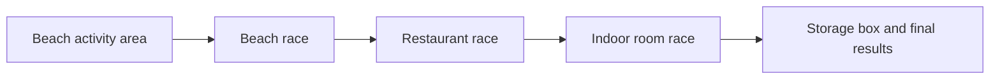

# After Hours Toy Race

## Game Design Document

**Project status:** In development  
**Genre:** Single-player 3D obstacle racing  
**Platform:** Desktop web browser  
**Engine:** Unity 6.3.x LTS  
**Build target:** WebGL  
**Complete playthrough target:** Under 10 minutes

## Game Concept

*After Hours Toy Race* takes place at a seaside hotel after its public facilities close. A group of toy robots has spent the day in the beach activity area. When the rental stand closes and the visitors leave, the toys come to life. Their home is a storage box in an indoor activity room. The robots turn the journey back into a race, following a route from the beach through the restaurant and into the room.

The player controls one robot against AI racers. Each short course has a clear start and finish. The robot runs forward automatically while the player steers around moving obstacles, collects speed boosts, and looks for a clear path through the oversized environment. The final course ends at the toys' storage box.

The **After Hours** theme shapes both the setting and the action. Beach equipment stands unused, dinner service has ended, and the indoor room has become quiet. Everyday objects become a miniature racing course once people have left. Evening lighting and small local lights show the route while preserving the sense of a closed space.

| Design element | Plan |
| --- | --- |
| Player | One animated toy robot |
| Opponents | AI toy robots with distinct colors |
| Perspective | Third-person follow camera |
| Main action | Automatic running and keyboard steering |
| Courses | Beach, Restaurant, Indoor Room |
| Race objective | Reach each finish ahead of the other toys |
| Final objective | Return to the storage box |
| Target duration | Approximately 2 to 2.5 minutes per course |

## Story

During the day, the hotel's toy robots are brought to the beach activity area. By evening, the visitors have gone and the equipment has been left in place. The closing lights come on. The robots wake near a rental basket and recognize the route back to their indoor storage box.

The first leg takes them across the beach. Umbrellas, loungers, paddles, inflatable boats, and buckets are much larger than the toys. The robots begin racing between these objects and head toward the restaurant terrace. Their playful competition gives the trip a clear pace: each toy wants to be the first back to the box.

The restaurant has finished dinner service. The robots use chair ramps, tables, and a connecting board to cross the room. Moving utensils and rolling food interrupt their path. The race continues through a doorway leading toward the indoor activity room.

In the last room, furniture and toys form the final course. The robots follow toy tracks, pass books and boxes, and reach the storage box. The player's finishing position and total play time appear with the results from all three courses. The opening and ending use brief in-game text and short character actions so the full journey remains within the assignment time limit.

## Design Goals

**A readable race:** The player can identify the next safe opening, nearby competitors, and their current position while running.

**A continuous journey:** The same robot and controls carry through all three courses. Each finish moves the group closer to the storage box.

**Distinct locations:** The beach, restaurant, and indoor room use their own objects, lighting, sounds, and obstacle layouts.

**A manageable scope:** The courses use continuous running surfaces, shared race systems, and repeatable obstacle behaviors. Boards and ramps connect changes in height.

## Core Gameplay Loop

1. Begin a course after a short countdown.
2. Run forward and steer through the route.
3. Avoid moving obstacles and slow areas.
4. Collect speed boosts and pass AI racers.
5. Cross the finish line and view position and course time.
6. Continue to the next location.
7. Reach the storage box and view the overall results.

## Controls and Camera

| Input | Action |
| --- | --- |
| A or Left Arrow | Steer left |
| D or Right Arrow | Steer right |
| Enter | Confirm a menu choice |
| P | Pause or resume a race |

The robot runs forward automatically when a race begins. Holding a direction key moves it sideways relative to the course. Releasing the key ends lateral movement. The course surface guides the robot along broad bends, boards, and ramps.

The camera follows from behind and slightly above the robot. It turns with the route and keeps upcoming hazards visible. The browser start screen prompts the player to click the game area to focus keyboard input. A visible pause control provides an additional way to stop the race.

## Race Structure and Rules

The initial race design contains one player and six AI opponents. All racers start together and follow the same course. Their movement speeds vary slightly, creating opportunities to overtake during clear sections and after obstacles.

Live position reflects progress along the course. Final placement follows the order in which racers cross the finish line. Every finishing position completes the course and allows the player to continue to the next location. Course results show the player's position and completion time. The last screen shows results for all three races and total play time.

Contact with a moving hazard returns the affected racer to the start of the current short course. Slow areas temporarily reduce running speed. Speed boosts temporarily increase it. Hazard frequency and course length will be tuned through playtesting so the full game can be completed within ten minutes.

## Obstacles and Pickups

| Element | Player effect | Example in the game |
| --- | --- | --- |
| Moving hazard | Collision returns the racer to the course start | Swinging paddle, sweeping spoon, moving toy train |
| Fixed obstacle | Occupies part of the route | Bucket, stacked plate, cardboard box |
| Slow area | Temporarily lowers running speed | Loose sand, spilled sauce, thick carpet |
| Speed boost | Temporarily raises running speed | Glowing pickup along a clear route |

Moving hazards use visible repeating patterns. Their travel range and timing leave an opening during each cycle. The first course introduces one hazard at a time. Later courses combine familiar movements in tighter spaces. Props, colliders, and motion timing are adjusted for the scale of each location.

## AI Racers

The AI racers are other toy robots returning to the same storage box. Distinct body colors make opponents easy to recognize. They share the player's route, start signal, hazards, pickups, and finish point.

Each course has its own navigable surface for AI movement. A small sequence of invisible route targets guides the AI through important turns and connections. On the restaurant course, for example, a racer travels to the first table, crosses the board, reaches the second table, and then heads for the finish. The navigation system handles movement between those targets.

Agent size and route width are set together. Wide fixed boards and ramps connect playable surfaces. The ranking system uses ordered route progress so a racer on a curved or elevated section receives the correct position. Finish crossing order determines the final result.

## Level Design

### Level 1 Beach

**Story role:** The robots leave the closed beach activity area and race toward the hotel restaurant terrace.

**Route:** Rental basket → umbrella passage → boat-side boardwalk → lounger corridor → terrace entrance.

**Environment:** Umbrellas, loungers, buckets, inflatable boats, beach balls, paddles, and a closed rental stand create the toy-scale beach. The sand and boardwalk form one continuous course.

**Hazards and pickups:** A sideways-moving beach ball or paddle teaches timing. A rotating beach toy creates a second movement pattern. Loose sand slows racers, while an early boost teaches pickup placement.

**Difficulty:** The opening has generous width. Hazards appear separately before a final section combines a moving obstacle and a boost opportunity.

**After Hours presentation:** A closed sign, empty loungers, cooler evening light, and warm lamps near the terrace mark the end of the day.

### Level 2 Restaurant

**Story role:** The robots cross the restaurant after dinner service to reach the indoor part of the hotel.

**Route:** Terrace chair ramp → first dining table → wide board bridge → second dining table → interior doorway.

**Environment:** Chairs, tables, plates, cups, food trays, utensils, and a preparation counter create elevated paths and recognizable landmarks. Fixed ramps and boards connect all running surfaces.

**Hazards and pickups:** A sweeping spoon blocks part of a table. A rolling food item crosses the next section. Spilled sauce slows racers. A boost on a clear side of the route rewards accurate steering.

**Difficulty:** Tables introduce height changes and tighter bends. Route targets guide AI racers across each table connection.

**After Hours presentation:** Stacked dishes, cleared seats, dim dining lights, and a remaining counter lamp show that service has ended.

### Level 3 Indoor Room

**Story role:** The toys make their final run to the storage box.

**Route:** Doorway → floor toy road → book ramp → table connection → storage box finish.

**Environment:** A bed, books, chairs, cardboard boxes, toy tracks, and scattered toys create the final miniature course. The storage box is visible near the end.

**Hazards and pickups:** A moving toy train crosses the course. A rotating barrier tests obstacle timing. A thick carpet section slows racers, and a final boost creates an overtaking chance.

**Difficulty:** The course combines known hazard types, then opens into a wider final approach where racers can change positions before the finish.

**After Hours presentation:** Low room lighting and small toy lights keep the route readable. The quiet room and returning toys complete the nighttime journey.

## Art and Animation

The game uses a stylized, low-poly look with large household objects and small toy characters. One robot model with color variants provides a consistent visual identity for the player and AI racers. The intended character is [Quaternius's Animated Robot Pack](https://quaternius.com/packs/animatedrobot.html). Running and idle animations support racing and menu presentation.

The player has a distinctive color and a small marker above the character. Moving obstacles have readable silhouettes, clear motion ranges, and collision shapes that match their visible forms. Beach, restaurant, and indoor props follow the team's visual references for scale and arrangement.

Lighting changes across the route: cool evening beach light, warm restaurant practical lights, and softer indoor room light. Route edges and hazards retain enough contrast for fast movement.

## Audio and User Interface

Audio includes a countdown, toy footsteps, moving obstacle sounds, impact, boost pickup, course finish, and final celebration. Waves identify the beach. A quiet interior ambience identifies the restaurant and indoor room.

| Screen | Content |
| --- | --- |
| Main menu | Start, Level Select, Audio Settings, Credits |
| Race display | Current position, timer, course progress, active boost, pause control |
| Pause menu | Resume, Restart Course, Main Menu |
| Course results | Position, time, Continue, Replay |
| Final results | Three course positions, total time, Replay, Main Menu |

Large text and simple icons support quick reading during a race. The opening displays a brief instruction for keyboard steering. Results appear promptly so the three-course journey stays short.

## Technical Design

The team will develop the game in **Unity 6.3.x LTS**, manage the project through **GitHub**, and submit a **WebGL build playable in a desktop browser**. The exact Unity patch version will be recorded with the final submission.

Each course needs a navigable route for AI racers, appropriately sized agent settings, route targets, and finish detection. Continuous fixed boards and ramps connect elevated sections. Player steering follows the local course direction, and the camera follows the same turns. Ranking measures progress through the ordered route and finish crossing order.

The team will test a small WebGL prototype early. Later browser tests cover loading, keyboard focus, menu input, AI navigation, moving obstacles, course transitions, results, and the complete playthrough. Simple collision shapes, restrained visual effects, and modest texture sizes support browser performance.

## Production Plan

| Milestone | Playable result |
| --- | --- |
| Core prototype | Robot movement, keyboard steering, one AI racer, one moving obstacle, browser build |
| Beach course | Complete route, pickups, AI navigation, race display, results |
| Three-course build | Restaurant, indoor room, transitions, route-based ranking |
| Final build | Lighting, audio, credits, browser testing, playthrough timing |

The team will complete the route through all three locations before adding final visual detail. GitHub commits will track changes to gameplay, scenes, UI, and assets. Scene ownership will be coordinated when team members work in parallel.

## Acceptance Criteria

- The game presents a complete Beach → Restaurant → Indoor Room journey after closing time.
- One human player competes against AI toy robots in all three courses.
- Every course has a continuous route that AI racers can complete.
- Moving obstacles, collision resets, speed boosts, and slow areas function in the themed environments.
- Keyboard steering, pause, restart, course results, and scene transitions work in a desktop browser.
- Live position reflects route progress, and final placement follows finish order.
- Every finishing position allows the player to continue the journey.
- The final race ends at the toys' storage box.
- A full first playthrough reaches the final results within ten minutes.
- The submitted project uses Unity 6.3.x LTS, GitHub version control, and a tested WebGL build.

## Credits and References

- [Quaternius Animated Robot Pack](https://quaternius.com/packs/animatedrobot.html), planned toy character, CC0 license.
- Team-provided beach, restaurant, and indoor room references, visual direction for layout and scale.

Additional external assets used in the final game will be listed here with their creators and licenses.
