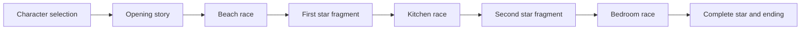

# After Hours Toy Race

## Game Design Document

**Project status:** In development
**Genre:** Single-player 3D obstacle racing and adventure
**Platform:** Desktop web browser
**Engine:** Unity 6.3.x LTS
**Build target:** WebGL
**Complete playthrough target:** Under 10 minutes

## Game Concept

*After Hours Toy Race* is a colorful third-person racing adventure about four toys searching for the pieces of a magical golden star. The journey begins at the beach, continues through a seaside kitchen, and ends in the bedroom where the toys once lived together.

The player chooses Flower Horse, Flower Horse B, or Horse and races against Elephant, Giraff, and Rabbit. Every level begins with a three-second visual countdown. The player completes two laps while navigating oversized objects, ramps, narrow connections, moving platforms, and dangerous fall areas. AI racers follow scene-specific NavMesh routes and compete for the same finish line.

Short story pages connect the three races. Each completed location reveals another part of the star mystery, and the final Bedroom race restores the complete golden star to Woody's saddle.

| Design element | Plan |
| --- | --- |
| Player | One selectable rocking-horse character |
| Opponents | Elephant, Giraff, and Rabbit AI racers |
| Perspective | Third-person follow camera |
| Main action | Run, steer, jump, avoid hazards, and complete two laps |
| Courses | Beach, Kitchen, Bedroom |
| Race objective | Finish two laps and achieve the best possible position |
| Final objective | Recover all three star fragments and restore the magic |
| Target duration | Approximately 2 to 3 minutes per course |

## Story

Woody and the other toys awaken to discover that the magical star has been broken into three fragments. Without the complete star, the warmth and magic of their world are beginning to fade. The four friends decide to follow its light and turn the search into a race.

The first race takes place at the beach. The toys run among oversized seaside objects and complete two laps while searching for the first fragment. When the race ends, a golden piece rises into the air and points toward the kitchen.

The second race continues through the seaside kitchen. Four racers cross the finish line and discover the second fragment. The two collected pieces respond to one another and create a glowing trail leading toward the bedroom. The toys follow the light, knowing that only one fragment remains.

The Bedroom is the final destination. After the last race, the third fragment appears and joins the first two pieces. The restored golden star fills the room with light before returning to Woody's saddle. The toys remember that this room is where their adventures began and decide that they will race together again.

## Design Goals

**A readable race:** Route markers, lap information, a stable follow camera, and visually distinct racers help the player understand where to go and who is ahead.

**A continuous journey:** Story pages connect Beach, Kitchen, and Bedroom so that each race advances the search for the star fragments.

**Distinct locations:** Each level uses a different environment, route shape, obstacle layout, and visual mood while sharing the same race systems.

**Player choice:** The character-selection screen lets the player use one of three horse models while the AI racers remain recognizable as Elephant, Giraff, and Rabbit.

**A manageable scope:** Shared countdown, navigation, ranking, pause, respawn, camera, and results systems are reused across all three scenes.

## Core Gameplay Loop

1. Choose a player character from the main menu.
2. View the opening story or select an unlocked level.
3. Begin the race after the 3, 2, 1, GO countdown.
4. Follow the route, jump over gaps, and avoid obstacles or death zones.
5. Complete two laps while racing three AI opponents.
6. View the final ranking and choose to replay, return to the menu, or continue.
7. Watch the story transition and enter the next location.
8. Complete the Bedroom race and restore the golden star.

## Controls and Camera

| Input | Action |
| --- | --- |
| W / A / S / D | Move the player |
| Space | Jump |
| Mouse movement | Rotate the third-person camera |
| Escape | Release the mouse cursor |
| Left Mouse Button | Capture the mouse cursor again |
| On-screen Settings button | Pause the race |

Movement is relative to the camera, allowing the player to steer freely around corners and line up jumps. The character model rotates toward its movement direction while the collision root remains stable.

The camera follows from behind and above the player. It turns with mouse input and keeps the selected character as its target in Beach, Kitchen, and Bedroom. The camera setup repairs its references at runtime if a scene is entered through the menu flow.

## Race Structure and Rules

Each race contains one player and three AI opponents. All racers wait for the visual countdown before starting. A level lasts two laps, and ordered route points track each racer's progress through the course.

The lap counter displays the current lap. Ranking is calculated from completed laps, the next route point, and progress along the current route segment. When the player finishes the second lap, the game compares all four racers and displays their names on a four-place ranking podium.

The results screen provides Replay, Main Menu, and Continue or Ending options. Beach continues to the Kitchen story, Kitchen continues to the Bedroom story, and Bedroom continues to the final ending sequence.

Falling into a death zone or hitting a lethal obstacle triggers the death and respawn system. The player returns to a valid checkpoint instead of restarting the entire game. AI racers use the same ordered course loop and continue into the second lap through a final-to-first navigation connection.

## Obstacles and Pickups

| Element | Player effect | Example in the game |
| --- | --- | --- |
| Moving obstacle | Requires timing or knocks the player away | Rotating rods and moving platforms |
| Fixed obstacle | Blocks a direct path and changes the racing line | Furniture, kitchen props, boxes, and toys |
| Gap or death zone | Triggers a death animation and checkpoint respawn | Areas below platforms and outside the course |
| Jump connection | Lets the player cross between separated surfaces | Ramps, boards, and short gaps |
| Route marker | Shows the next required section of the course | Floating marker above the next waypoint |

Obstacle movement uses visible, repeating patterns so the player can read a safe opening. Colliders and death regions are adjusted separately for each scene. Checkpoints prevent a single mistake from removing too much progress, while two-lap races allow players to learn the course during the first lap and improve during the second.

## AI Racers

The three opponents are Elephant, Giraff, and Rabbit. Different models and proportions make each racer easy to identify on the course and ranking screen. Their movement speeds vary slightly to create overtaking opportunities.

Every level has its own baked NavMesh and an ordered set of editable route points. Kitchen uses its established navigation route, Beach has a scene-specific course with shortcut links, and Bedroom contains twenty route points for detailed adjustment. NavMesh Links connect jumps, separated surfaces, and the last route point back to the first.

The AI begins at the forward route point instead of returning to the starting grid, preventing a racer from initially travelling in the wrong direction. Navigation agents orient toward their movement path, traverse links, complete laps, and report their progress to the shared ranking manager.

## Level Design

### Level 1 Beach

**Story role:** The first race begins the search and reveals the first golden star fragment.

**Route:** Starting grid → seaside obstacle route → connected platforms and jumps → final corner → starting line for lap two.

**Environment:** A bright toy-scale beach filled with oversized seaside props, boards, platforms, and playful obstacles.

**Hazards and pickups:** Moving or rotating obstacles interrupt the route, while gaps and out-of-bounds areas use death regions and checkpoint respawns.

**Difficulty:** Broad opening sections introduce movement and camera control before later route points require more accurate steering and jumping.

**After Hours presentation:** The abandoned play area becomes a secret racing course once the toys awaken and begin following the first fragment's light.

### Level 2 Restaurant

**Story role:** The Kitchen race reveals the second fragment and the final clue pointing toward the Bedroom.

**Route:** Kitchen starting grid → elevated counters and connected surfaces → obstacle sections → finish line → second lap.

**Environment:** A warm seaside toy kitchen with oversized pots, utensils, counters, food props, bridges, and narrow connections.

**Hazards and pickups:** Rotating and moving course objects require timing. Falling from raised surfaces triggers the recovery system.

**Difficulty:** Height changes and narrower connections demand more precise movement. AI route points and navigation links guide racers through each important section.

**After Hours presentation:** Warm indoor lighting contrasts with the Beach and makes the second glowing star fragment feel brighter when it appears.

### Level 3 Indoor Room

**Story role:** The final race reveals the third fragment, completes the golden star, and returns the toys to the room where their adventures began.

**Route:** Bedroom starting grid → floor route around furniture and toys → connected obstacle sections → final straight → second lap and ending.

**Environment:** A warm Bedroom containing a bed, shelves, blocks, a toy train, a teddy bear, and other familiar childhood objects.

**Hazards and pickups:** Bedroom-specific death areas and navigation connections keep both the player and AI on the intended route.

**Difficulty:** Twenty editable route points create a longer closed course and allow precise tuning of AI turns, jumps, and the final return to the starting line.

**After Hours presentation:** Golden light fills the room during the ending as all three star fragments join and the magic returns.

## Art and Animation

The game uses a colorful handcrafted toy style with painted wood, warm lighting, and oversized environments. The UI uses wooden signs, toy-like buttons, illustrated level cards, a 3D countdown, and a four-place ranking podium.

The player can select Flower Horse, Flower Horse B, or Horse. Their imported materials and textures preserve the floral, wooden, and rocking-horse designs. Elephant, Giraff, and Rabbit are the three AI opponents. Model visuals are placed under separate character roots so their position, rotation, and scale can be adjusted without changing movement or collision logic.

Story pages use gold and dark-blue presentation panels to match the magical star narrative. Beach, Kitchen, and Bedroom retain different environmental colors while sharing the same playful visual identity.

## Audio and User Interface

The game currently focuses on clear visual feedback, with space for countdown, jump, impact, magical chime, finish, and ambient sounds. The Bedroom ending specifically calls for a gentle magical chime when the three fragments form the complete star.

| Screen | Content |
| --- | --- |
| Main menu | Play, Level Select, Settings |
| Character selection | Flower Horse, Flower Horse B, Horse |
| Story pages | Click anywhere to advance dialogue and narration |
| Race display | Lap counter, next-route guidance, Settings button |
| Pause menu | Resume, Main Menu |
| Course results | Four-place ranking, Replay, Main Menu, Continue |
| Final ending | Completed star story and Thank You for Playing message |

Large text and simple buttons support fast reading. The Settings button pauses gameplay by setting the game time scale to zero. Returning to the race restores the previous time scale and mouse capture. The main menu closes its settings panel when loaded so no menu appears unexpectedly.

## Technical Design

The project is developed in **Unity 6.3.x LTS**, managed through **GitHub**, and prepared for a **WebGL build playable in a desktop browser**.

Player movement uses Unity's Input System, a Character Controller, camera-relative movement, jumping, gravity, obstacle response, death, and checkpoint recovery. The third-person orbit camera follows the active player character and restores missing scene references when required.

AI movement uses Unity NavMesh surfaces, ordered waypoints, NavMesh agents, and NavMesh Links. Beach, Kitchen, and Bedroom have independent navigation data because their geometry and jump connections differ. Shared race logic manages the countdown, two-lap progress, AI spawning, ranking, result screen, pause menu, and scene transitions.

The main menu connects to character selection, the opening story, and level selection. All three gameplay scenes are included in Build Settings. Runtime story pages connect Beach to Kitchen, Kitchen to Bedroom, and Bedroom to the final ending.

## Production Plan

| Milestone | Playable result |
| --- | --- |
| Core prototype | Player movement, jump, follow camera, one AI route, and obstacle response |
| Beach course | Complete two-lap route, death zones, AI navigation, ranking, and first story transition |
| Three-course build | Kitchen and Bedroom races, three AI models, character selection, and connected narrative |
| Final build | Audio polish, obstacle tuning, WebGL testing, credits, and complete playthrough timing |

The current build contains the connected three-level race structure, character selection, three AI racers, ranking UI, pause controls, story transitions, and the final ending. Remaining production work should focus on playtesting, audio, course balancing, WebGL performance, and final asset credits.

## Acceptance Criteria

- The game presents a complete Beach → Kitchen → Bedroom journey.
- The player can select Flower Horse, Flower Horse B, or Horse.
- One human player competes against Elephant, Giraff, and Rabbit in all three courses.
- Every race begins after a 3, 2, 1, GO countdown and lasts two laps.
- Every course has a baked NavMesh, ordered route points, and a closed loop that AI racers can complete.
- Player movement, jumping, third-person camera control, pause, respawn, and scene transitions function correctly.
- Falling into a death zone returns the player to a valid checkpoint.
- Live progress and final placement use route order, lap count, and finish progress.
- The ranking screen displays all four racer names and provides replay, menu, and continuation controls.
- Kitchen completion plays the Bedroom transition story.
- Bedroom completion restores the star and displays the final message.
- Beach, Kitchen, and Bedroom are accessible through the connected flow and level-selection screen.
- A complete playthrough can be finished within the intended time target.
- The final WebGL build is tested in a desktop browser.

## Credits and References

- Unity Engine and Unity AI Navigation, used for runtime, input, scene management, and NavMesh systems.
- Team-created and team-provided wooden toy UI artwork, level cards, countdown graphics, story direction, and environment references.
- Imported Flower Horse, Flower Horse B, Horse, Elephant, Giraff, and Rabbit models and their associated materials and textures.
- Third-party environment and obstacle assets included in the Unity project.

Creators, source links, and licenses for every external model, texture, sound, and environment package should be confirmed and listed before final submission.
